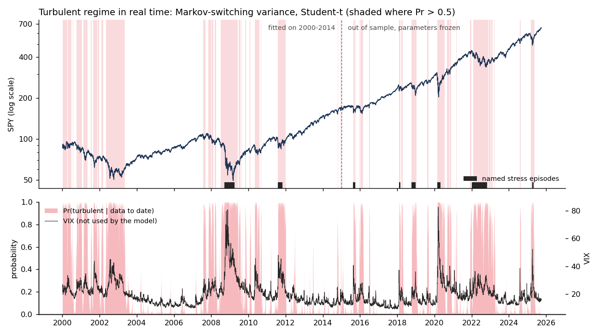
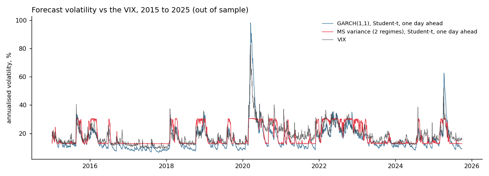
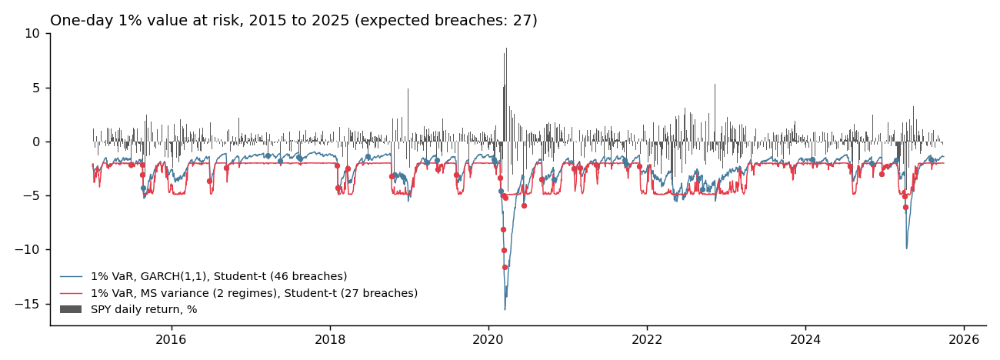

# Regime-switching volatility for the S&P 500, tested out of sample

Fits GARCH, Markov-switching variance (a hidden Markov model) and Markov-switching GARCH to
daily SPY returns from 2000 to 2014. It then freezes the parameters and asks what each model
gets right from January 2015 to September 2025: day-ahead return densities, value at risk, and
whether its "turbulent" regime switches on during real market stress. All the likelihoods, the
Hamilton filter and the Kim smoother are written from scratch in NumPy.



## The short answer

- **For tomorrow's volatility, plain GARCH(1,1) with Student-t errors is as good as anything here.**
  Neither Markov-switching GARCH beats it out of sample (Diebold–Mariano p = 0.53 and 0.33).
- **For spotting crises, the simple hidden Markov model is the one that works.** In real time and
  out of sample, its turbulent regime was on for 84 to 100% of the days in every stress episode
  since 2015 (the August 2015 devaluation, Volmageddon, Q4 2018, COVID, 2022 and the April 2025
  tariff shock), and on for 17% of other days. It never sees the VIX, yet its regime probability
  correlates 0.71 with it.
- **Combining the two in one MS-GARCH gives you neither.** Maximum likelihood turns its two
  regimes into a daily mixture that fattens the tails (Pr(stay in calm) ≈ 0), not into regimes
  you can read.

So: use GARCH-t for the volatility number and a hidden Markov model for the regime flag.

## Results

**In sample (2000–2014, 3,772 days)**

| Model | Params | Log-lik | BIC | Regime vol, calm / turbulent | Pr(stay), calm / turbulent |
| --- | --- | --- | --- | --- | --- |
| GARCH(1,1), Gaussian | 4 | −5,412.5 | 10,858 | | |
| **GARCH(1,1), Student-t** | 5 | −5,352.5 | **10,746** | | |
| MS variance, Gaussian | 5 | −5,570.9 | 11,183 | 12% / 32% | 0.992 / 0.982 |
| MS variance, Student-t | 6 | −5,479.6 | 11,009 | 12% / 31% | 0.994 / 0.988 |
| MS-GARCH, Gaussian | 9 | −5,342.7 | 10,759 | 11% / 22% | 0.020 / 0.554 |
| MS-GARCH, Student-t | 10 | **−5,334.1** | 10,751 | 11% / 22% | 0.000 / 0.679 |
| MS-GARCH, Student-t, persistent | 10 | −5,339.2 | 10,761 | 11% / 21% | 0.959 / 0.985 |

MS-GARCH has the best likelihood (and AIC), but BIC prefers GARCH-t: five extra parameters
buy 18 log-likelihood points. The hidden Markov model's regimes are the readable ones: a 12%
volatility state lasting about 163 days per visit and a 31% state lasting about 83.

**Out of sample (January 2015 to September 2025, 2,701 days, parameters frozen)**

| Model | Avg log score | DM vs GARCH-t (p) | QLIKE | 1% VaR breaches (27 expected) | Kupiec p | Independence p |
| --- | --- | --- | --- | --- | --- | --- |
| GARCH(1,1), Gaussian | −1.299 | +5.2 (<0.001) | 0.759 | 58 | <0.001 | 0.009 |
| **GARCH(1,1), Student-t** | **−1.262** | | 0.761 | 46 | <0.001 | 0.008 |
| MS variance, Gaussian | −1.333 | +5.2 (<0.001) | 0.857 | 41 | 0.012 | 0.026 |
| MS variance, Student-t | −1.302 | +5.0 (<0.001) | 0.878 | **27** | **0.999** | <0.001 |
| MS-GARCH, Gaussian | −1.274 | +2.7 (0.006) | 0.767 | 49 | <0.001 | 0.002 |
| MS-GARCH, Student-t | −1.264 | +0.6 (0.53) | 0.762 | 48 | <0.001 | 0.001 |
| MS-GARCH, Student-t, persistent | −1.265 | +1.0 (0.33) | 0.769 | 48 | <0.001 | 0.011 |

The log score is the average log predictive density of each day's return (higher is better).
A positive Diebold–Mariano statistic means a worse score than GARCH-t.

**Is the turbulent regime on during known stress? (share of days with filtered Pr > 0.5)**

| Episode | MS variance, t | MS-GARCH, t | MS-GARCH, t, persistent |
| --- | --- | --- | --- |
| Global financial crisis, Sep 2008 to Mar 2009 *(in sample)* | 100% | 99% | 99% |
| US downgrade, Aug to Oct 2011 *(in sample)* | 95% | 100% | 100% |
| China devaluation, Aug to Sep 2015 | 84% | 100% | 100% |
| Volmageddon, Feb 2018 | 94% | 100% | 100% |
| Q4 2018 selloff | 90% | 98% | 92% |
| COVID crash, Feb to Apr 2020 | 96% | 100% | 100% |
| 2022 bear market | 89% | 100% | 99% |
| Tariff shock, Apr 2025 | 100% | 100% | 95% |
| **All other days since 2015** | **17%** | 95% | 76% |
| Correlation with the VIX since 2015 | **0.71** | 0.13 | 0.47 |

The MS-GARCH regimes look perfect on the episodes only because they are on almost all the time.

**What the numbers say**

- **Fat tails matter more than regimes.** Moving from Gaussian to Student-t errors is the biggest,
  most significant improvement for every model.
- **The hidden Markov model is a good detector but a poor forecaster.** Its forecast volatility can only
  move between about 13% and 31% (see below), so in March 2020 it said 31% while one-month
  realised volatility reached 92%. That costs it on log score, and its VaR breaches cluster in the first days of each
  shock (independence p < 0.001), before the regime flips. Its tail is fat enough that the
  *count* of 1% breaches is exactly right, 27 against 27 expected.
- **Every GARCH under-predicts the 1% tail since 2015** (46 to 58 breaches against 27). The tails
  of the 2015–2025 market were fatter than 2000–2014 data suggested; refitting the parameters
  regularly is the obvious fix (see Limitations).
- **The MS-GARCH likelihood has two peaks.** The global maximum switches regime almost daily: a
  quieter GARCH and a more volatile one, mixed day by day, which is a way of fattening the tails. Restricting the search to persistent regimes (Pr(stay) ≥ 0.95, a bound that does not bind
  at the answer) finds a second local maximum only 5 log-likelihood points lower. It is a 24-day
  quiet state and a 67-day "normal" state, and it is no better out of sample. Knowing which peak
  you are on matters before reading anything into MS-GARCH regimes.





## How it works

| Module | What it does |
| --- | --- |
| `regime/data.py` | SPY and VIX from 2000, cached; the training cut-off and the stress episodes (fixed before any results) |
| `regime/dists.py` | Gaussian and unit-variance Student-t densities, CDFs and quantiles |
| `regime/markov.py` | Hamilton filter (likelihood, predicted and filtered regime probabilities), Kim smoother |
| `regime/models.py` | GARCH(1,1), Markov-switching variance and Haas MS-GARCH; maximum likelihood from several starts; VaR from the predictive mixture |
| `regime/evaluate.py` | QLIKE, Diebold–Mariano with Newey–West errors, Kupiec and Christoffersen VaR tests |
| `scripts/compare.py` | Fits everything on 2000–2014, scores 2015–2025, writes the tables in `docs/` |
| `scripts/report.py` | Charts |

**Why Haas MS-GARCH.** If each regime's GARCH variance fed on its *own* past, the variance today
would depend on the whole path of regimes, 2^T of them, and the likelihood could not be computed
exactly (Gray 1996 and Klaassen 2002 approximate it). Haas, Mittnik and Paolella (2004) run each
regime's GARCH on the observed shocks instead:

```
σ²_k,t = ω_k + α_k ε²_t−1 + β_k σ²_k,t−1      for each regime k
```

so every σ²_k,t is known the day before. The Hamilton filter then gives the exact likelihood, and
the predictive distribution of tomorrow's return is a mixture of K densities weighted by
Pr(regime | data to date). VaR is the quantile of that mixture, found by bisection.

**No look-ahead.** Parameters come from 2000–2014 only. From 2015 the filter runs forward one
day at a time, so every forecast, VaR and regime probability uses only data up to the day
before (filtered, not smoothed). The VIX is used only to check the results, never as an input.

## Testing

16 tests (`pytest -q`):
- The Hamilton filter's likelihood and the Kim smoother's posteriors **match brute-force
  enumeration over every regime path**, for 2 and 3 regimes, and survive densities of 1e−870
- GARCH via `lfilter` matches an explicit loop; MS-GARCH with identical regimes collapses to
  plain GARCH whatever the transition matrix
- Fitting recovers simulated GARCH-t parameters, and simulated switching variances and
  transition probabilities, labelling calm and turbulent correctly whatever the simulation order
- The VaR solves the mixture CDF to 1e−9; Student-t densities integrate to one with unit variance
- Kupiec matches its closed form; Christoffersen flags clustered breaches only; QLIKE is minimised
  by the true variance; Diebold–Mariano detects a genuinely better forecast

## Limitations

- **Parameters frozen for ten years.** A fair test of the 2014 models, but in practice you would
  refit at least yearly, which would likely fix most of GARCH's 1% VaR shortfall.
- **One asset, two regimes.** Three regimes, or a joint model of stocks and bonds (where the
  2022 regime is the interesting one), are natural extensions.
- **Maximum likelihood with local optima.** Six starts per model, and the MS-GARCH section shows
  why that matters. A Bayesian fit (MCMC) would show the two peaks directly as a bimodal posterior.
- **The stress list is short and judgement-based.** Many "other days" the hidden Markov model flags
  are around episodes not on the list, like the rest of 2020 after the crash.

## Run it

```bash
python3 -m venv .venv && source .venv/bin/activate
pip install -r requirements.txt
pytest -q
PYTHONPATH=. python scripts/compare.py    # downloads data on first run; about 15 minutes
PYTHONPATH=. python scripts/report.py
```

## References

- Bollerslev, T. (1986). *Generalized autoregressive conditional heteroskedasticity.* Journal of Econometrics.
- Hamilton, J. D. (1989). *A new approach to the economic analysis of nonstationary time series and the business cycle.* Econometrica.
- Kim, C.-J. (1994). *Dynamic linear models with Markov-switching.* Journal of Econometrics.
- Gray, S. F. (1996). *Modeling the conditional distribution of interest rates as a regime-switching process.* Journal of Financial Economics.
- Klaassen, F. (2002). *Improving GARCH volatility forecasts with regime-switching GARCH.* Empirical Economics.
- Haas, M., Mittnik, S. and Paolella, M. S. (2004). *A new approach to Markov-switching GARCH models.* Journal of Financial Econometrics.
- Kupiec, P. (1995). *Techniques for verifying the accuracy of risk measurement models.* Journal of Derivatives.
- Christoffersen, P. (1998). *Evaluating interval forecasts.* International Economic Review.
- Diebold, F. X. and Mariano, R. S. (1995). *Comparing predictive accuracy.* Journal of Business and Economic Statistics.
- Patton, A. J. (2011). *Volatility forecast comparison using imperfect volatility proxies.* Journal of Econometrics.

---

Yuvraj Chawla · M.S. Quantitative Finance, Northeastern University · [yuvrajchawla.si](https://yuvrajchawla.si)
